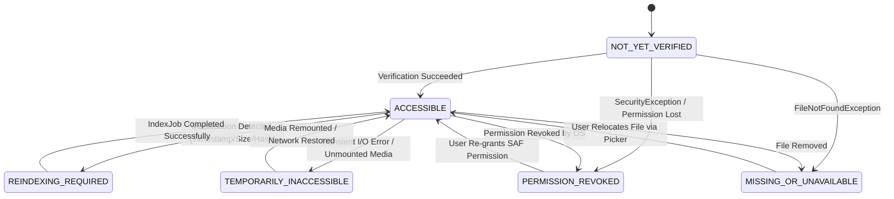

# Project MemoMint — Phase 4: File Indexing & Document Retrieval

> **Phase Status:** Completed  
> **Roadmap Target:** Phase 4 (Section 21 of `PROJECT_MEMOMINT.md`)  
> **Completion Criterion:** Supported documents (plain text, markdown, PDF, DOCX) can be indexed, verified, and searched locally with full-text search, with permissions, incremental updates, error states, and unavailable sources handled honestly and transparently.  
> **Guiding Principles:** Section 11.6 (`FileReference`), Section 11.8 (`IndexJob`), Section 13.2 (Document Processing), Section 13.3 (Incremental Indexing), Section 15.3 (File-Health Status), FR-08 (File Health), NFR-02 (Offline Execution), NFR-03 (Data Integrity), NFR-08 (Graceful Degradation).

---

## 1. Executive Summary & Purpose

In Phases 1 through 3, MemoMint built a structured, associative memory system capable of storing notes, extracting contextual facts (items, locations, dates, keywords), linking memories through shared entities, and retrieving them using full-text search, synonym expansion, and depth-1 graph traversal.

However, real personal knowledge is frequently stored in **local files and documents**:
- Price comparisons in a spreadsheet or document (`notes_final_3.docx`).
- Appliance user manuals or warranty receipts (`dishwasher_manual.pdf`).
- Plain text configurations, research logs, and markdown journals (`journal_2026.md`).

Phase 4 empowers MemoMint to index and search local document contents completely **offline**, without cloud dependencies, heavy neural models, or invasive storage permissions.

### Core Objectives
1. **Scoped Storage Compliance:** Access only user-selected files and folders via Android's Storage Access Framework (SAF) with persisted URI permissions.
2. **Zero-Cloud Document Parsing:** Extract text locally from plain text (`.txt`, `.md`, `.json`, `.csv`), Microsoft Word (`.docx`), and Adobe PDF (`.pdf`) using lightweight, memory-efficient streaming parsers.
3. **Full-Text Document Indexing:** Index extracted document bodies into SQLite full-text search (`files_fts`) with BM25 ranking, sharing the proven FTS5 $\rightarrow$ FTS4 $\rightarrow$ FTS3 fallback cascade.
4. **Incremental Indexing & Deduplication:** Compare file metadata, modification timestamps, and content fingerprints (SHA-256) to avoid costly re-parsing of unchanged files.
5. **Truthful File-Health Monitoring:** Continuously verify file availability and permission states. Never conflate permission revocation or temporary device detachment with file deletion.
6. **Graceful Fallbacks & Deep Error Containment:** Fall back to metadata-only search when document text parsing is blocked (e.g. encrypted files or scanned image-only PDFs), providing actionable recovery options to the user.
7. **Dedicated Debugging & Diagnostic Activities:** Provide built-in debugging screens and audit tools to inspect index job queues, review extracted text streams, test health transitions, and simulate permission revocations.

---

## 2. Architectural Design & Component Pipeline

### 2.1 File Ingestion & SAF Permission Model

Android 11+ (API 30+) strictly enforces Scoped Storage. Direct filesystem paths (`/sdcard/...`) are inaccessible for arbitrary user documents. MemoMint interacts with documents exclusively through the **Storage Access Framework (SAF)**:

```
[User Action: Pick File / Folder]
       |
       v
Intent.ACTION_OPEN_DOCUMENT / ACTION_OPEN_DOCUMENT_TREE
       |
       v
ContentResolver.takePersistableUriPermission(uri, Intent.FLAG_GRANT_READ_URI_PERMISSION)
       |
       v
FileReference created with URI string (e.g., "content://com.android.providers.media.documents/...")
       |
       v
FileIndexingService.enqueueFile(fileReference)
```

**Key Invariants:**
- Persistable permissions are acquired immediately upon URI reception via `takePersistableUriPermission()`.
- URI strings are stored in `file_references.uri_or_path`.
- If the permission is revoked by the user or OS, the reference is marked `PERMISSION_REVOKED`; the underlying indexed record is **not deleted** (Section 15.3).

---

### 2.2 Document Processing & Indexing Pipeline

When an indexing job executes in the background worker thread, it progresses through five deterministic stages:

```
[IndexJob: PENDING]
       |
       v
Stage 1: Pre-flight & Health Check
       |-- Check URI accessibility via ContentResolver.query()
       |-- Evaluate Exclusion Rules (hidden files, unsupported extensions, size > 25MB)
       |-- If inaccessible -> update access_state, mark job FAILED with ErrorCode
       v
Stage 2: Incremental Change Detection
       |-- Compare last_modified_at and size_bytes with existing FileReference
       |-- If unchanged -> mark job DONE (SKIPPED_UNCHANGED), update last_verified_at
       |-- Compute streaming SHA-256 fingerprint; if matching -> skip re-parsing
       v
Stage 3: Streaming Document Parsing
       |-- Resolve DocumentParser based on MIME type and file extension
       |-- Stream text chunks (max 1MB in-memory buffer) to prevent OutOfMemoryError
       |-- If parse error / encrypted -> Trigger Parser Fallback Hierarchy
       v
Stage 4: Text-Content & Context Indexing
       |-- Write extracted text into files_fts (FTS5 / FTS4 / FTS3 table)
       |-- Run KeywordExtractor to extract key vocabulary into context_records
       |-- Link FileReference to generated ContextRecords
       v
Stage 5: Transactional Commit & Status Update
       |-- Update file_references (last_indexed_at, content_fingerprint, indexing_status=DONE)
       |-- Update index_jobs (status=DONE, progress=100)
```

---

### 2.3 Search Pipeline Integration

The retrieval pipeline from Phase 2 and 3 seamlessly incorporates indexed documents. Searches simultaneously query memories and document contents:

```
User Query: "guitar comparison"
       |
       v
SearchService.searchSync(query)
       |
       |-- Parallel Retrieval:
       |     |-- Memory Retrieval (FTS memories_fts + Synonyms + Relations)
       |     |-- Document Retrieval (FTS files_fts + Filename LIKE)
       |
       v
Candidate Merger & Ranker
       |-- Memory candidates scored via 5-component RelevanceScorer
       |-- Document candidates scored via DocumentScorer (text BM25 + filename match + freshness)
       |-- Merged and sorted by composite relevance score
       |
       v
Explanations Generated:
       - Memory: "Exact match on 'guitar'"
       - Document: "Found in document 'notes_final_3.docx' (Section: Acoustic Guitars)"
```

---

## 3. Comprehensive Fallback Strategy

The application must operate reliably across diverse Android device configurations, broken files, legacy formats, and varying SQLite builds without throwing unhandled exceptions.

```
+-------------------------------------------------------------------------------+
|                        PARSER FALLBACK HIERARCHY                              |
+-------------------------------------------------------------------------------+
|                                                                               |
|  [PDF Parsing]                                                                |
|    |--> 1. Primary: Lightweight Pure-Java Stream Text Extractor               |
|    |--> 2. Secondary: Android Native PdfRenderer Text Stream Probing          |
|    |--> 3. Fallback: If 0 text streams found -> Flag SCANNED_PDF_NEEDS_OCR    |
|    +--> 4. Ultimate Fallback: Metadata-Only Indexing (Filename + Display Name)|
|                                                                               |
|  [DOCX Parsing]                                                               |
|    |--> 1. Primary: ZipInputStream streaming word/document.xml with SAX Parser|
|    |--> 2. Secondary: Raw Zip entry text scanner                              |
|    +--> 3. Ultimate Fallback: Metadata-Only Indexing                           |
|                                                                               |
|  [Plain Text Parsing]                                                         |
|    |--> 1. Primary: UTF-8 Stream Reader with replacement on malformed bytes   |
|    |--> 2. Secondary: UTF-16LE / UTF-16BE BOM auto-detection                  |
|    +--> 3. Fallback: ISO-8859-1 (Latin-1) lossless byte-to-char mapping       |
|                                                                               |
|  [FTS Full-Text Search Virtual Table]                                         |
|    |--> 1. FTS5 with BM25 ranking (preferred)                                 |
|    |--> 2. FTS4 with prefix matching (standard Android fallback)              |
|    |--> 3. FTS3 ultra-compatible table (JVM / legacy engine fallback)          |
|    +--> 4. SQL LIKE query across file_references metadata & text store        |
|                                                                               |
|  [Storage Access Framework URI Access]                                        |
|    |--> 1. ContentResolver persistent read stream                             |
|    |--> 2. DocumentFile metadata query fallback                               |
|    +--> 3. Flag PERMISSION_REVOKED or MISSING without deleting index data     |
+-------------------------------------------------------------------------------+
```

### 3.1 PDF Parsing Fallback Hierarchy
1. **Primary Parser (`PdfStreamTextParser`):** A zero-dependency, pure Java streaming PDF parser that reads page text objects (`BT ... ET` blocks and `Tj`/`TJ` operators) with Deflate decompression. Fast, memory-light (< 2MB heap), and requires no external binaries.
2. **Encrypted / Password Protected:** Detect `/Encrypt` dictionary in PDF trailer. Catch security exception, flag error code `ERR_PDF_ENCRYPTED`, and fall back to metadata-only indexing.
3. **Scanned Image-Only PDF:** If the PDF parser succeeds but extracts 0 text characters across $\ge 1$ pages, flag file status `SCANNED_NEEDS_OCR`. Inform user honestly via UI: *"Document is scanned image; text extraction requires OCR."* (FR-08). Never fabricate content.
4. **Metadata Fallback:** If PDF parsing fails due to malformed xref tables or corrupt streams, index the file's display name, directory path, and last modified timestamp into `files_fts` so the file remains findable by name.

### 3.2 DOCX Parsing Fallback Hierarchy
1. **Primary Parser (`DocxSaxParser`):** Microsoft Word `.docx` files are ZIP archives containing XML. `DocxSaxParser` uses standard `java.util.zip.ZipInputStream` to locate `word/document.xml` and parses paragraphs (`<w:p>`) and text runs (`<w:t>`) using Android's built-in `org.xmlpull.v1.XmlPullParser` or SAX parser. Avoids massive 30MB Apache POI dependencies.
2. **Corrupted ZIP Entry:** If decompression fails or XML is malformed, log `ERR_DOCX_CORRUPT` and fall back to indexing file metadata.

### 3.3 Plain Text & Markdown Fallback Hierarchy
1. Read using `StandardCharsets.UTF_8` with `CodingErrorAction.REPLACE` so invalid byte sequences do not crash the parser.
2. Inspect initial byte order mark (BOM) for UTF-16LE (`0xFF 0xFE`) or UTF-16BE (`0xFE 0xFF`).
3. Fall back to `StandardCharsets.ISO_8859_1` if UTF decoding fails.

### 3.4 Full-Text Search Fallback Cascade (`files_fts`)
Following the exact pattern established in Phase 2 & 3:
- Check `sqlite_compileoption_used('ENABLE_FTS5')` $\rightarrow$ create `files_fts USING fts5(id UNINDEXED, file_id UNINDEXED, title, content, tokenize = 'unicode61 remove_diacritics 2')`.
- Fall back to `FTS4` if FTS5 is not compiled into the device's SQLite engine.
- Fall back to `FTS3` for complete compatibility across all Android ROMs and Robolectric JVM test environments.
- Fall back to relational `LIKE` queries if virtual tables are unavailable.

---

## 4. Robust Error Handling Architecture

File indexing encounters unpredictable filesystem events: SD cards are unmounted, files are renamed outside the app, permissions expire, and memory is constrained. Every error must be explicitly classified and handled.

### 4.1 Error Codes (`IndexErrorCode`)

| Error Code | Category | Cause | Handling & User Recovery Action |
|---|---|---|---|
| `ERR_PERMISSION_REVOKED` | Access | User revoked URI permission or cleared media storage | Mark `access_state = PERMISSION_REVOKED`. Provide "Re-grant Permission" button in UI. Do not delete index. |
| `ERR_FILE_NOT_FOUND` | Access | File moved, renamed, or deleted outside MemoMint | Mark `access_state = MISSING_OR_UNAVAILABLE`. Show "Locate File" or "Remove Reference" options. |
| `ERR_FILE_TOO_LARGE` | Guard | File size exceeds max indexing limit (default: 25 MB) | Mark `indexing_status = EXCLUDED`. Index metadata only. Explain size limit in UI. |
| `ERR_EMPTY_FILE` | Parsing | File size is 0 bytes | Mark `indexing_status = DONE`, 0 content rows. |
| `ERR_PDF_ENCRYPTED` | Parsing | PDF has owner/user password protection | Mark `indexing_status = FAILED`, log reason. Offer metadata-only indexing. |
| `ERR_PDF_SCANNED` | Parsing | PDF contains bitmap images with no embedded text streams | Mark `indexing_status = DONE_WITHOUT_TEXT`, explain OCR requirement. |
| `ERR_DOCX_CORRUPT` | Parsing | ZIP structure or `document.xml` is malformed | Mark `indexing_status = FAILED`. Keep metadata indexed. |
| `ERR_IO_TIMEOUT` | I/O | Reading from slow/stalled external cloud-backed provider | Retry once with exponential backoff; if persistent, mark `TEMPORARILY_INACCESSIBLE`. |
| `ERR_OUT_OF_MEMORY` | Guard | JVM heap pressure during large document stream | Catch `OutOfMemoryError`, release buffers, trigger `System.gc()`, log error, skip content. |

### 4.2 File Health State Machine



---

## 5. Debugging Activities & Developer Diagnostics

Phase 4 introduces specialized debugging tools to allow comprehensive inspection of file states, parser output, and search ranking during development and testing.

### 5.1 `FileIndexingDebugActivity` (`dev.builtbyahnaf.memomint.ui.debug.FileIndexingDebugActivity`)

A dedicated developer & diagnostics activity accessible from Settings or developer launcher:

#### Key Diagnostic Capabilities:
1. **Interactive File Picker & Inspector:** Select any file via SAF and view live:
   - Extracted metadata (URI, display name, MIME type, size, last modified).
   - Raw extracted text preview (first 2,000 characters).
   - Extraction latency in milliseconds and memory consumption.
2. **Live Index Job Monitor:**
   - Real-time display of active, queued, and completed jobs from `index_jobs` table.
   - Job progress bar (0–100%), timestamps, and error codes.
   - Buttons to "Cancel Job", "Retry Failed Jobs", and "Clear Completed Jobs".
3. **Health State Simulator:**
   - Simulate `PERMISSION_REVOKED` without altering actual device settings.
   - Simulate file disappearance (`MISSING_OR_UNAVAILABLE`) to test UI degradation.
   - Trigger manual "Run Full Health Check" across all tracked files.
4. **FTS Document Query Sandbox:**
   - Enter raw search queries and inspect BM25 scores, term highlights, and match snippets directly from `files_fts`.

### 5.2 Structured Diagnostic Logging (`FileLog`)
Centralized logging under tag `MemoMint:FileIndex`:
- `FileLog.d("IndexJob [job-id] started for URI: %s", uri)`
- `FileLog.w("Parser fallback engaged for file '%s': reason=%s", fileName, reason)`
- `FileLog.e("Health check failed for file '%s': error=%s", fileName, errorCode)`

---

## 6. Component Specifications & Interfaces

### 6.1 Domain Models

#### `FileReference.java` (`domain/model/FileReference.java`)
```java
public final class FileReference {
    private final String id;
    private final String uriOrPath;
    private final String displayName;
    private final String mimeType;
    private final long sizeBytes;
    private final Long lastModifiedAt;
    private final Long lastIndexedAt;
    private final String contentFingerprint;
    private final AccessState accessState;
    private final Long lastVerifiedAt;
    private final IndexingStatus indexingStatus;
    private final boolean excluded;
    // Constructor, getters, withAccessState(), withIndexingStatus() immutability helpers
}
```

#### `IndexJob.java` (`domain/model/IndexJob.java`)
```java
public final class IndexJob {
    private final String id;
    private final String sourceId; // references file_references.id
    private final Status status;    // PENDING, RUNNING, DONE, FAILED, CANCELLED
    private final int progress;     // 0 to 100
    private final Long startedAt;
    private final long updatedAt;
    private final String errorCode; // from IndexErrorCode
    // Constructor, getters, updateProgress(), markDone(), markFailed()
}
```

#### Enums
- `AccessState`: `ACCESSIBLE`, `NOT_YET_VERIFIED`, `TEMPORARILY_INACCESSIBLE`, `MISSING_OR_UNAVAILABLE`, `PERMISSION_REVOKED`, `REINDEXING_REQUIRED`.
- `IndexingStatus`: `PENDING`, `RUNNING`, `DONE`, `DONE_WITHOUT_TEXT`, `FAILED`, `EXCLUDED`.

---

### 6.2 Parser Subsystem (`domain/file/parser/`)

#### `DocumentParser.java` (Interface)
```java
public interface DocumentParser {
    /** Checks whether this parser supports the given mime type or file extension. */
    boolean supports(String mimeType, String extension);
    
    /**
     * Parses text content from the input stream.
     * @param inputStream open stream to the document
     * @param maxChars maximum characters to extract (safety ceiling)
     * @return extraction result containing text, metadata, and page count
     * @throws DocumentParseException on fatal, non-recoverable parse failure
     */
    ParseResult parse(InputStream inputStream, int maxChars) throws DocumentParseException;
}
```

#### `ParseResult.java`
```java
public final class ParseResult {
    private final String extractedText;
    private final int characterCount;
    private final int pageCount;
    private final boolean truncated;
    private final Map<String, String> documentMetadata; // author, title, creation date if present
}
```

#### Implementations:
1. `PlainTextParser`: Reads UTF-8, Markdown, JSON, CSV with BOM detection.
2. `DocxSaxParser`: Streams `word/document.xml` from ZIP stream using XML pull parsing.
3. `PdfStreamTextParser`: Pure Java deflated stream extractor extracting text from PDF page content streams.
4. `DocumentParserFactory`: Resolves appropriate parser based on MIME type and extension, with fallback to `PlainTextParser`.

---

### 6.3 Repositories (`data/repository/`)

#### `FileReferenceRepository.java` (Interface)
```java
public interface FileReferenceRepository {
    void save(FileReference fileReference);
    FileReference findById(String id);
    FileReference findByUri(String uriOrPath);
    List<FileReference> findAll(int limit);
    List<FileReference> findByAccessState(AccessState state);
    void updateAccessState(String id, AccessState state, long verifiedAt);
    void updateIndexingStatus(String id, IndexingStatus status, Long indexedAt, String fingerprint);
    void delete(String id); // Unlinks reference and removes associated files_fts rows
}
```

#### `IndexJobRepository.java` (Interface)
```java
public interface IndexJobRepository {
    void enqueue(IndexJob job);
    IndexJob findNextPendingJob();
    void updateStatus(String jobId, IndexJob.Status status, int progress, String errorCode);
    List<IndexJob> findActiveJobs();
    List<IndexJob> findRecentJobs(int limit);
}
```

#### `FileSearchRepository.java` (Interface)
```java
public interface FileSearchRepository {
    void indexDocumentContent(String fileId, String title, String textContent);
    void removeDocumentContent(String fileId);
    List<FileSearchResult> searchFiles(String query, int limit);
}
```

---

### 6.4 Application Services (`application/`)

#### `FileIndexingService.java`
- Orchestrates background indexing jobs using `backgroundExecutor`.
- Tracks progress (0–100%) and publishes updates to `index_jobs` table.
- Enforces exclusion rules: file size limit (25 MB), extensions (`.bin`, `.exe`, `.apk`, `.zip`, `.mp4`).
- Computes streaming SHA-256 fingerprint for incremental change detection.

#### `FileHealthService.java`
- Periodically verifies persisted URIs via `ContentResolver`.
- Emits health check reports and alerts UI when permissions expire.

---

## 7. Database Schema Extensions (Schema Version 3)

Phase 4 introduces **Schema Version 3** to add the dedicated `files_fts` virtual table for fast full-text searching across indexed documents.

### DDL Specification (`DatabaseConstants.java`)

```sql
-- FTS5 Definition (Preferred)
CREATE VIRTUAL TABLE IF NOT EXISTS files_fts USING fts5(
    id UNINDEXED,
    file_id UNINDEXED,
    title,
    content,
    tokenize = 'unicode61 remove_diacritics 2'
);

-- FTS4 Fallback Definition
CREATE VIRTUAL TABLE IF NOT EXISTS files_fts USING fts4(
    id,
    file_id,
    title,
    content,
    tokenize=unicode61
);

-- FTS3 Fallback Definition
CREATE VIRTUAL TABLE IF NOT EXISTS files_fts USING fts3(
    id,
    file_id,
    title,
    content
);
```

### Migration Implementation (`MemoMintDatabase.java`)
- Increment `DATABASE_VERSION = 3`.
- In `onUpgrade`, add `case 2: applyMigrationV2toV3(db);`.
- Use `isModuleSupported(db, "fts5")` capability detection to select FTS5 $\rightarrow$ FTS4 $\rightarrow$ FTS3.
- Register repair logic in `onOpen` to auto-heal `files_fts` if created with an unsupported module.

---

## 8. Test Strategy & Labeled Benchmarks (`test_modules/`)

Phase 4 test suites will reside in `app/src/test/java/dev/builtbyahnaf/memomint/test_modules/` to allow inspection and independent verification.

### 8.1 Test Suites to Implement

1. **`PlainTextParserTest.java`**
   - Extracts plain ASCII text.
   - Extracts UTF-8 with accents and diacritics.
   - Handles UTF-16 BOM files cleanly without corrupt characters.
   - Truncates oversized text at `maxChars` ceiling safely.

2. **`DocxParserTest.java`**
   - Parses standard multi-paragraph `.docx` fixture.
   - Ignores embedded styles, font tables, and XML tags.
   - Handles corrupted / non-ZIP file gracefully with `DocumentParseException`.

3. **`PdfParserTest.java`**
   - Parses single-page and multi-page text-based PDF fixtures.
   - Detects encrypted PDF fixture and throws `DocumentParseException(ERR_PDF_ENCRYPTED)`.
   - Detects image-only scanned PDF (0 text chars) and returns empty text with flag.

4. **`IncrementalIndexingTest.java`**
   - Computes identical SHA-256 fingerprint for identical files.
   - Skips re-indexing when timestamp and size are unchanged.
   - Triggers re-indexing when content changes.

5. **`FileHealthStateTest.java`**
   - Verifies state transitions: `NOT_YET_VERIFIED` $\rightarrow$ `ACCESSIBLE`.
   - Simulates `SecurityException` $\rightarrow$ verifies `PERMISSION_REVOKED` without data loss.
   - Simulates `FileNotFoundException` $\rightarrow$ verifies `MISSING_OR_UNAVAILABLE`.

6. **`FileSearchIntegrationTest.java`**
   - Indexes sample documents into `files_fts`.
   - Searches for content inside documents (e.g., `"guitar prices"` matching `notes_final_3.docx`).
   - Verifies snippet extraction and term highlighting.

---

## 9. File Inventory for Phase 4

| Layer | File Path | Purpose |
|---|---|---|
| **Domain Models** | `domain/model/FileReference.java` | Tracks indexed document metadata and health state |
| | `domain/model/IndexJob.java` | Background indexing job representation |
| | `domain/model/AccessState.java` | State enumeration for document availability |
| | `domain/model/IndexingStatus.java` | Status enumeration for indexing progress |
| | `domain/model/IndexErrorCode.java` | Standardized error code constants |
| **Parsing Engine** | `domain/file/parser/DocumentParser.java` | Parser interface contract |
| | `domain/file/parser/ParseResult.java` | Extracted text and document metadata container |
| | `domain/file/parser/DocumentParseException.java` | Explicit parser error wrapper with error codes |
| | `domain/file/parser/PlainTextParser.java` | Parser for `.txt`, `.md`, `.json`, `.csv` |
| | `domain/file/parser/DocxSaxParser.java` | Zero-dependency ZIP/XML streaming parser for `.docx` |
| | `domain/file/parser/PdfStreamTextParser.java` | Lightweight Deflate/PDF stream parser for `.pdf` |
| | `domain/file/parser/DocumentParserFactory.java` | MIME/extension resolver with fallback cascade |
| **Exclusion & Guard** | `domain/file/ExclusionPolicy.java` | Evaluates file size, extensions, and hidden paths |
| | `domain/file/ContentFingerprinter.java` | Streaming SHA-256 hasher for incremental indexing |
| **Persistence** | `data/database/DatabaseConstants.java` | Schema v3 constants (`files_fts`, indexes) |
| | `data/database/MemoMintDatabase.java` | Migration v2 $\rightarrow$ v3 with FTS5/4/3 fallback |
| | `data/repository/FileReferenceRepository.java` | Interface for `file_references` CRUD |
| | `data/repository/FileReferenceRepositoryImpl.java` | SQLite implementation for `file_references` |
| | `data/repository/IndexJobRepository.java` | Interface for `index_jobs` queue |
| | `data/repository/IndexJobRepositoryImpl.java` | SQLite implementation for `index_jobs` |
| | `data/repository/FileSearchRepository.java` | Interface for full-text document indexing |
| | `data/repository/FileSearchRepositoryImpl.java` | SQLite implementation querying `files_fts` |
| **Application** | `application/FileIndexingService.java` | Coordinates background worker jobs and status updates |
| | `application/FileHealthService.java` | Verifies URI permissions and file availability |
| | `application/SearchService.java` | Extended to merge document search results with memories |
| **Diagnostics & UI** | `ui/debug/FileIndexingDebugActivity.java` | Dedicated debug activity for live inspection |
| | `res/layout/activity_file_indexing_debug.xml` | Layout for developer inspection screen |
| **Tests** | `test_modules/PlainTextParserTest.java` | Unit tests for text and markdown parser |
| | `test_modules/DocxParserTest.java` | Unit tests for DOCX XML parser |
| | `test_modules/PdfParserTest.java` | Unit tests for PDF parser and fallback triggers |
| | `test_modules/IncrementalIndexingTest.java` | Unit tests for fingerprinting and delta detection |
| | `test_modules/FileHealthStateTest.java` | Unit tests for health state transitions |
| | `test_modules/FileSearchIntegrationTest.java` | Integration test for document FTS retrieval |

---

## 10. Phase 4 Completion Criteria Checklist

- [ ] `FileReference` and `IndexJob` domain models and enums implemented.
- [ ] Schema Version 3 implemented with `files_fts` and FTS5 $\rightarrow$ FTS4 $\rightarrow$ FTS3 fallback cascade in `MemoMintDatabase`.
- [ ] `PlainTextParser` implemented with UTF-8, UTF-16, and ISO-8859-1 charset fallbacks.
- [ ] `DocxSaxParser` implemented using streaming `ZipInputStream` and XML pull parser (zero external dependencies).
- [ ] `PdfStreamTextParser` implemented with encrypted PDF detection and scanned PDF detection.
- [ ] `DocumentParserFactory` implemented with graceful fallback to metadata-only indexing on parse failure.
- [ ] `ExclusionPolicy` enforcing 25 MB size limits, hidden files exclusion, and binary extension filters.
- [ ] `ContentFingerprinter` providing streaming SHA-256 calculation for incremental change detection.
- [ ] `FileReferenceRepositoryImpl` and `IndexJobRepositoryImpl` persisting records via SQLite.
- [ ] `FileSearchRepositoryImpl` indexing and querying document contents via `files_fts`.
- [ ] `FileIndexingService` executing background jobs with progress (0–100%) and error code reporting.
- [ ] `FileHealthService` verifying SAF URI permissions and detecting `PERMISSION_REVOKED` / `MISSING_OR_UNAVAILABLE`.
- [ ] `SearchService` augmented to return ranked document hits alongside memory matches.
- [ ] `FileIndexingDebugActivity` implemented providing live job inspection, parser testing, and health simulation.
- [ ] Unit test suites implemented in `test_modules/` covering text/docx/pdf parsers, health checks, and FTS search.
- [ ] All existing Phase 1–3 tests maintained (84+ tests passing).
- [ ] No remote or cloud dependencies introduced; 100% offline local execution verified.
